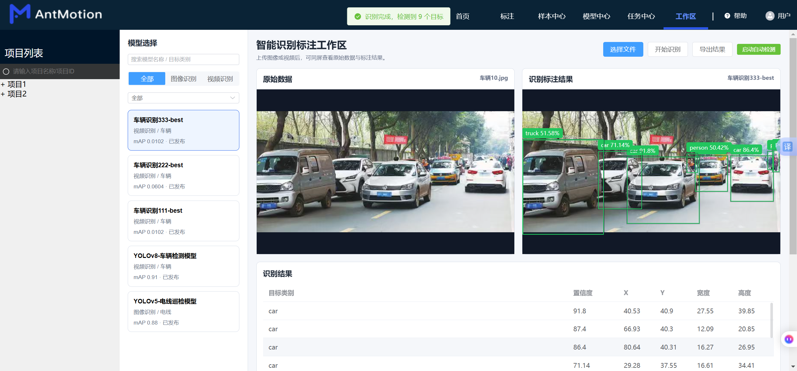
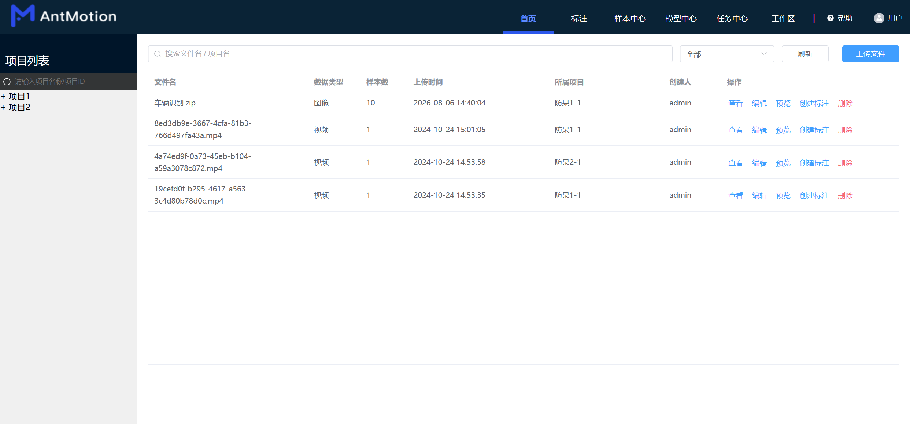
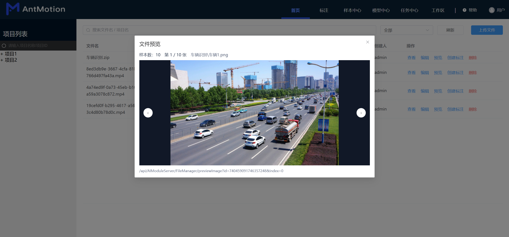
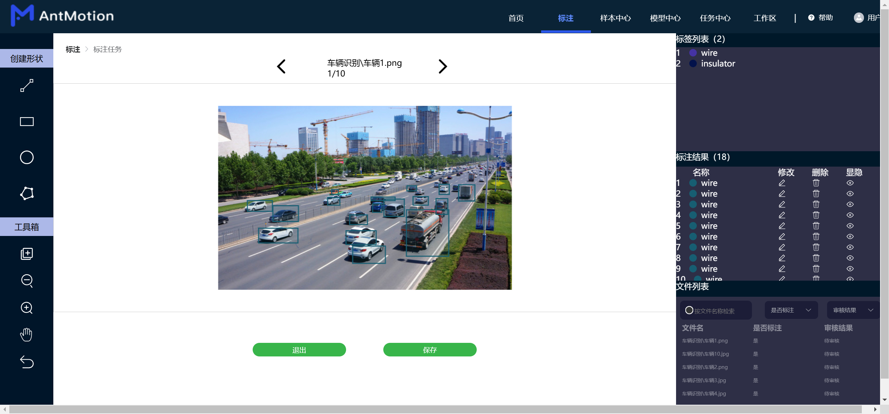
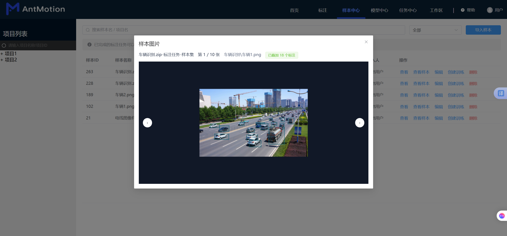
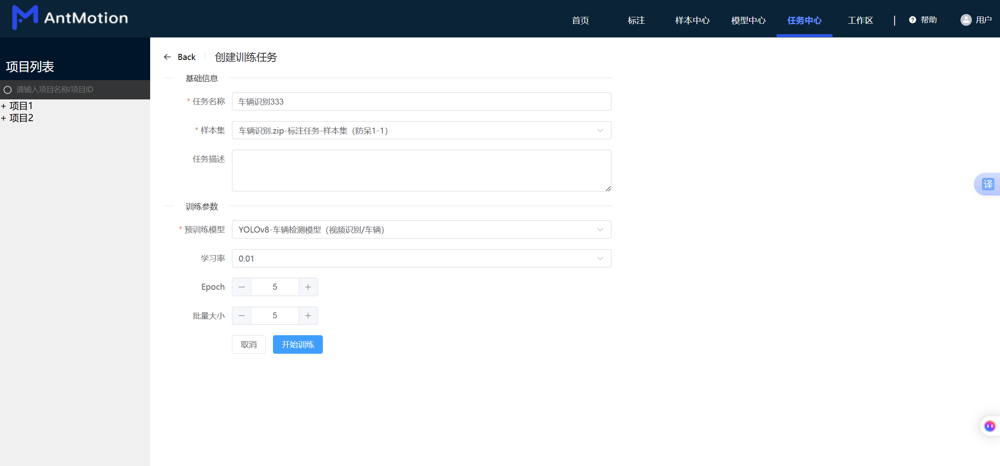
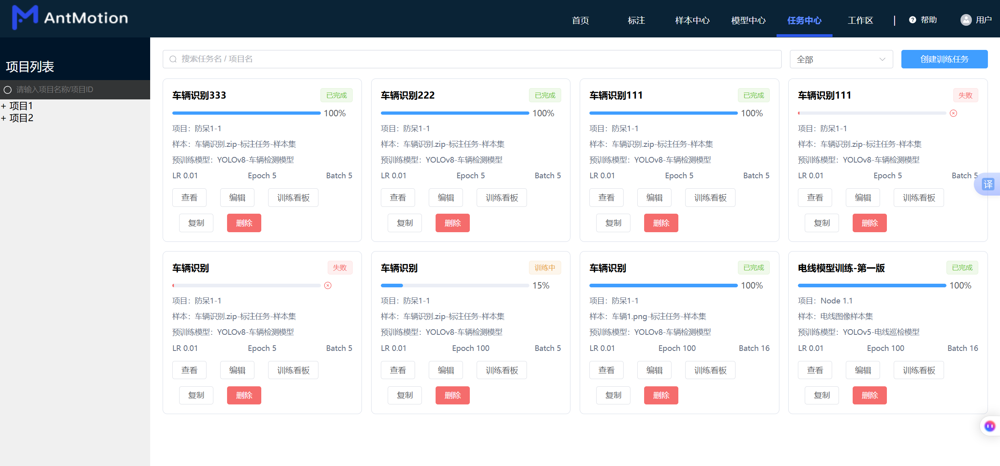
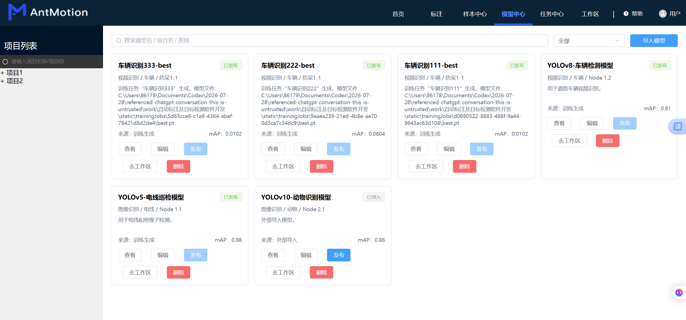

# AntMotion 自动标注与目标检测平台

面向计算机视觉数据生产与模型验证的一体化平台，覆盖 **文件上传、ZIP 多图解析、人工标注、样本管理、YOLO 模型训练、模型发布、目标识别和相机目录自动检测** 等流程。

项目采用前后端分离架构：前端基于 Vue 3，业务后端基于 Spring Boot 与 PostgreSQL，目标检测和训练能力由本地 Python/Ultralytics YOLO 提供。



## 核心能力

- **文件管理**：支持 JPG、PNG、MP4、ZIP 等文件上传、查询、编辑、删除和预览。
- **ZIP 数据集解析**：自动统计压缩包中的有效图片，可按图片顺序左右切换预览。
- **图像标注**：支持矩形框创建、移动、缩放、删除、类别设置和多图逐张标注。
- **结果持久化**：文件、标注任务、标注框、样本集和训练任务均可保存至 PostgreSQL。
- **样本中心**：将已完成标注的任务导入样本集，并查看带标注框的样本图片。
- **模型训练**：从样本集创建 YOLO 训练任务，展示训练状态、轮次、进度和指标。
- **模型管理**：管理训练生成或外部导入的模型，并将已发布模型用于识别。
- **智能识别**：对比展示原始图片和检测结果，输出类别、置信度与检测框坐标。
- **相机自动检测**：监听指定目录，对相机传入的新图片自动执行目标识别。

## 业务流程

```text
上传图片或 ZIP 数据集
        ↓
创建标注任务并逐图标注
        ↓
保存标注结果并导入样本中心
        ↓
选择样本集创建训练任务
        ↓
发布训练模型并进入识别工作区
        ↓
手动选择文件或监听相机目录进行检测
```

## 界面展示

### 1. 文件管理与数据集预览

首页统一管理图像、视频和 ZIP 数据集。ZIP 文件会显示实际样本数量，并支持逐张预览。

<p align="center">
  
  
</p>

### 2. 多图标注

标注工作区提供绘制工具、标签列表、标注结果列表和数据集图片导航，可对 ZIP 中的图片逐张处理。



### 3. 样本中心

完成标注后可一键导入样本中心。样本预览会重新绘制已保存的标注框，并显示当前图片序号和标注数量。



### 4. 创建与管理训练任务

训练任务可配置样本集、预训练模型、学习率、Epoch 和批量大小；任务中心统一展示等待、训练中、完成和失败状态。

<p align="center">
  
  
</p>

### 5. 模型中心

模型中心管理训练生成和外部导入的模型，展示模型来源、任务类型、目标类别和 mAP，并提供发布与进入工作区操作。



## 技术栈

| 模块 | 技术 |
| --- | --- |
| Web 前端 | Vue 3、TypeScript、Vite、Element Plus、Pinia、Vue Router、Axios、Fabric.js |
| 业务后端 | Java 8、Spring Boot 2.2、Spring Cloud、MyBatis Mapper、Maven |
| 数据库 | PostgreSQL |
| AI 能力 | Python、Ultralytics YOLOv8、PyTorch |
| 模型文件 | 默认使用 `yolov8n.pt`，支持训练生成和外部导入模型 |

## 目录结构

```text
.
├─ docs/screenshots/                 # README 界面截图
├─ junrui/dltools/                   # Vue 3 前端项目
├─ Java_proj/
│  ├─ postgres.sql                   # 主业务数据库脚本
│  ├─ AIDetection.sql                # 目标检测演示相关脚本
│  └─ idtserver/mrserver/            # Spring Boot Maven 多模块项目
│     ├─ ai/                         # 文件、标注、样本、训练与识别服务
│     ├─ auth/                       # 认证服务
│     ├─ user/                       # 用户服务
│     ├─ gateway/                    # API 网关
│     └─ common/                     # 公共模块
├─ cameraInbox/                      # 本地相机监听目录（运行时生成）
├─ static/                           # 上传、训练和识别结果（运行时生成）
└─ start-backend.bat                 # 本地后端启动脚本
```

## 本地运行

### 1. 环境要求

- Node.js 20 或兼容版本
- JDK 8
- Maven 3.6+
- PostgreSQL 16 或兼容版本
- Python 3.9+
- Python 包：`ultralytics`、`torch` 及其运行依赖

安装 AI 依赖：

```bash
pip install ultralytics
```

> `yolov8n.pt` 属于本地模型权重，已被 `.gitignore` 忽略。首次运行前请将权重文件放在仓库根目录，或通过 `YOLO_MODEL_PATH` 指定其他位置。

### 2. 初始化 PostgreSQL

创建业务数据库：

```sql
CREATE DATABASE auto_label_detection;
```

使用 `psql` 导入表结构和初始化数据：

```bash
psql -h localhost -p 5432 -U postgres -d auto_label_detection -f Java_proj/postgres.sql
```

如需目标检测演示数据，再执行：

```bash
psql -h localhost -p 5432 -U postgres -d auto_label_detection -f Java_proj/AIDetection.sql
```

### 3. 配置环境变量

后端支持通过环境变量覆盖本机配置：

```bash
DB_URL=jdbc:postgresql://localhost:5432/auto_label_detection
DB_USERNAME=postgres
DB_PASSWORD=你的数据库密码
JWT_SECRET=你的JWT密钥
NACOS_SERVER_ADDR=localhost:8848
YOLO_MODEL_PATH=yolov8n.pt
CAMERA_WATCH_PATH=cameraInbox
CAMERA_RESULTS_PATH=static/cameraResults
```

Nacos 默认关闭，普通本地开发不需要单独启动。

### 4. 启动后端

在 IDEA 中打开：

```text
Java_proj/idtserver/mrserver
```

文件管理、标注、训练和识别功能至少需要启动：

```text
ai/src/main/java/com/idtserver/mrserver/AIApplication.java
```

如需完整登录与网关流程，再启动：

```text
auth/src/main/java/com/idtserver/mrserver/AuthApplication.java
user/src/main/java/com/idtserver/mrserver/UserApplication.java
gateway/src/main/java/com/idtserver/mrserver/GatewayApplication.java
```

| 服务 | 端口 |
| --- | ---: |
| Gateway | 80 |
| Auth | 81 |
| User | 82 |
| AI Module | 83 |

也可以在仓库根目录运行：

```bat
start-backend.bat
```

### 5. 启动前端

```bash
cd junrui/dltools
npm install
npm run dev
```

开发环境会将 `/api/AIModuleServer` 代理到 `http://localhost:83`。

## 常见问题

### 页面提示后端暂不可用

确认 `AIApplication` 已启动且端口 83 未被其他进程占用，再检查前端代理配置和数据库连接。

### 识别请求超时

首次识别需要加载 YOLO 模型，耗时通常高于后续请求。请确认 Python、Ultralytics 和模型权重均可用，并查看 AI 服务日志中的模型加载信息。

### ZIP 上传后无法显示全部图片

确认压缩包内文件为受支持的图片格式，并检查 `static/originalFiles` 是否具有写入权限。预览页显示的样本数应与有效图片数一致。

### Maven clean 无法删除 JAR

先停止正在运行的 Java 服务或关闭占用该 JAR 的进程，再重新执行 Maven clean/package。

## 协作约定

- 不提交 `node_modules`、Maven `target`、日志和本地运行数据。
- 不提交数据库密码、JWT 密钥或其他本机敏感配置。
- 不提交大型模型权重；通过 README 或发布页说明模型获取方式。
- 功能分支提交前至少完成前端类型检查、后端编译和对应业务流程验证。

## 当前状态

项目已经打通以下核心链路：

```text
文件上传 → ZIP 解析 → 多图标注 → 标注保存 → 样本导入
→ 训练任务 → 训练进度 → 模型发布 → 目标识别/相机自动检测
```

目前主要面向本地开发与教学实践环境，生产部署前仍建议补充统一身份认证、对象存储、任务队列、模型版本管理和自动化测试。
